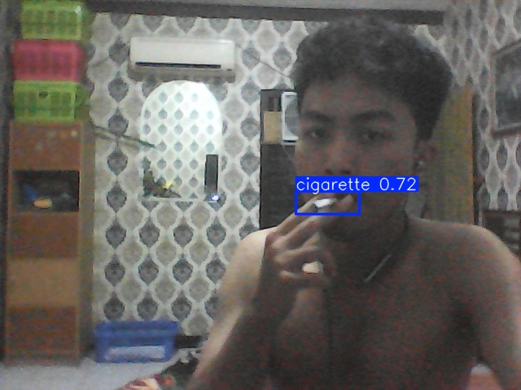

# EYE-Trac 🛡️🚬

**EYE-Trac** adalah sistem deteksi pelanggaran merokok (*Kawasan Tanpa Rokok / KTR*) secara *real-time* berbasis **Computer Vision (YOLOv11)** yang terintegrasi dengan **Telegram Bot**, **Google Cloud (Pub/Sub & Cloud Run)**, dan **Firebase (Firestore & Storage)**.

Proyek ini dirancang untuk memantau area bebas rokok secara otomatis melalui kamera lokal maupun *edge-to-cloud pipeline*, mendeteksi objek rokok (`cigarette`), menyimpan bukti visual, serta mengirimkan notifikasi peringatan secara instan.

---

## ✨ Fitur Utama

- **Deteksi Real-Time Berbasis YOLOv11**: Mendeteksi objek `cigarette` dari feed kamera secara langsung dengan *bounding box* dan *confidence score*.
- **Dua Mode Operasional**:
  - **Local Mode (`smoke.py`)**: Berjalan langsung di perangkat lokal/laptop, menyimpan tangkapan bukti lokal, dan mengirim foto peringatan ke Telegram dengan sistem *cooldown* (15 detik) untuk mencegah spam.
  - **Edge-to-Cloud Mode (`edge_pub.py` + `main.py`)**: *Edge gateway* mengirimkan frame terkompresi (`640x480` JPEG) ke **Google Cloud Pub/Sub**, lalu diproses oleh service **Flask** di **Google Cloud Run**.
- **Cloud Evidence & Logging (`main.py`)**:
  - Mengunggah gambar hasil deteksi beranotasi ke **Firebase Storage** (`pelanggaran/IMG_<timestamp>.jpg`).
  - Mencatat metadata pelanggaran (`akurasi`, `waktu`, `foto_url`, `lokasi`, `status`) ke **Cloud Firestore** pada koleksi `pelanggaran`.
- **Notifikasi Telegram Instan**: Mengirimkan laporan detail (objek, akurasi, waktu, dan bukti gambar/tautan) langsung ke Telegram Bot.
- **Siap Deploy dengan Docker**: Dilengkapi `Dockerfile` untuk deployment kontainer ke Google Cloud Run.

---

## 🏗️ Arsitektur & Struktur Proyek

```text
EYE-Trac/
├── smoke.py            # Mode lokal: deteksi kamera + kirim foto bukti ke Telegram
├── edge_pub.py         # Edge gateway: capture kamera & publish frame ke Google Cloud Pub/Sub
├── main.py             # Cloud backend (Flask): terima Pub/Sub, deteksi YOLO, simpan ke Firebase & alert Telegram
├── 1.py                # Skrip eksperimen: stream RTSP + model OpenVINO
├── Dockerfile          # Konfigurasi container untuk Google Cloud Run
├── requirements.txt    # Daftar dependensi Python
├── evidence.jpg        # Contoh hasil tangkapan deteksi
├── .env.example        # Template environment variables
└── .gitignore          # Mengecualikan venv, kredensial sensitif, log, dan model besar
```

### Alur Kerja Edge-to-Cloud
```text
[Kamera / Edge Device]
        │ (edge_pub.py: resize 640x480, JPEG 80%)
        ▼
[Google Cloud Pub/Sub]
        │ (Push Subscription / Base64 payload)
        ▼
[Cloud Run - main.py (Flask + YOLOv11)]
        ├──► [Firebase Storage]  (Simpan gambar bukti beranotasi)
        ├──► [Cloud Firestore]   (Simpan log metadata pelanggaran)
        └──► [Telegram Bot API]  (Kirim notifikasi peringatan)
```

---

## 📸 Hasil Deteksi

Berikut adalah contoh hasil deteksi sistem saat mengenali objek `cigarette` dengan tingkat kepercayaan (**confidence**) `0.72`:



Ketika pelanggaran terdeteksi, sistem akan mengirimkan notifikasi ke Telegram seperti format berikut:

**Mode Lokal (`smoke.py`):**
```text
⚠️ PELANGGARAN TERDETEKSI

👤 Objek: Merokok
📍 Lokasi: Lab Informatika UMS
⏱️ Waktu: 2026-04-24 19:36:10
🎯 Akurasi: 0.72
Status: Terekam di Local Storage
```

**Mode Cloud (`main.py`):**
```text
⚠️ PELANGGARAN KTR!
Terdeteksi: cigarette
Akurasi: 0.72
Waktu: 2026-04-24 19:36:10
Bukti: https://storage.googleapis.com/...
```

---

## 🚀 Cara Pemakaian

### 1. Prasyarat
- **Python 3.9+**
- **Webcam / Kamera** (untuk mode lokal atau edge gateway)
- **Model YOLOv11 (`yolo11.pt`)**: Letakkan file model hasil training (`yolo11.pt`) di direktori root proyek *(file model >100MB tidak disertakan di repositori ini)*.
- **Telegram Bot**: Buat bot melalui [@BotFather](https://t.me/BotFather) untuk mendapatkan `TELEGRAM_BOT_TOKEN` dan siapkan `TELEGRAM_CHAT_ID` tujuan.
- *(Opsional - Khusus Mode Cloud)*: Akun **Google Cloud Platform** (Pub/Sub & Cloud Run) dan **Firebase** (Firestore & Storage) beserta file kredensial `gcp-key.json` dan `service_account.json`.

### 2. Instalasi

Clone repositori dan masuk ke direktori proyek:
```bash
git clone https://github.com/Haydar13D/EYE-Trac.git
cd EYE-Trac
```

Buat dan aktifkan *virtual environment*, lalu instal dependensi:
```bash
# Windows (PowerShell)
python -m venv venv
.\venv\Scripts\Activate.ps1

# Linux / macOS
python3 -m venv venv
source venv/bin/activate

# Instal library
pip install -r requirements.txt
```

*(Catatan: Untuk menjalankan `smoke.py` atau `edge_pub.py` dengan tampilan GUI `cv2.imshow`, pastikan terinstal `opencv-python`, bukan hanya `opencv-python-headless`.)*

### 3. Konfigurasi Environment Variables

Salin file `.env.example` atau set environment variable secara langsung sebelum menjalankan aplikasi:

**Windows (PowerShell):**
```powershell
$env:TELEGRAM_BOT_TOKEN="your_telegram_bot_token_here"
$env:TELEGRAM_CHAT_ID="your_telegram_chat_id_here"
```

**Linux / macOS:**
```bash
export TELEGRAM_BOT_TOKEN="your_telegram_bot_token_here"
export TELEGRAM_CHAT_ID="your_telegram_chat_id_here"
```

### 4. Menjalankan Aplikasi

#### Opsi A: Mode Lokal (`smoke.py`)
Mode paling cepat untuk demo atau pengujian langsung menggunakan webcam tanpa setup cloud:
```bash
python smoke.py
```
- Jendela **EYE-TRAC Local Monitoring** akan terbuka.
- Tekan tombol **`q`** pada keyboard untuk menghentikan program.

#### Opsi B: Mode Edge-to-Cloud (`edge_pub.py` + `main.py`)
1. **Setup Backend Cloud (`main.py`)**:
   - Letakkan `service_account.json` (kredensial Firebase Admin) dan `yolo11.pt` di root proyek.
   - Build & deploy kontainer menggunakan `Dockerfile` ke Google Cloud Run, lalu hubungkan dengan Push Subscription dari Google Cloud Pub/Sub.
   - Set environment variable `TELEGRAM_BOT_TOKEN` dan `TELEGRAM_CHAT_ID` di konfigurasi Cloud Run.
2. **Jalankan Edge Gateway (`edge_pub.py`)**:
   - Letakkan `gcp-key.json` (kredensial GCP Pub/Sub Publisher) di root proyek.
   - Sesuaikan `PROJECT_ID` dan `TOPIC_ID` di `edge_pub.py` jika berbeda.
   - Jalankan script:
     ```bash
     python edge_pub.py
     ```
   - Tekan **`q`** pada jendela monitoring untuk keluar.

---

## 🛠️ Tech Stack

- **Bahasa**: Python 3.9+
- **Computer Vision & AI**: Ultralytics YOLOv11, OpenCV, NumPy
- **Backend & Container**: Flask, Gunicorn, Docker
- **Cloud & Database**: Google Cloud Pub/Sub, Google Cloud Run, Firebase Firestore, Firebase Storage
- **Notifikasi**: Telegram Bot API

---

## 🔒 Catatan Keamanan

File kredensial seperti `gcp-key.json`, `service_account.json`, dan `.env` telah dimasukkan ke dalam `.gitignore`. **Jangan pernah mengunggah file kredensial atau token bot asli ke repositori publik.**
